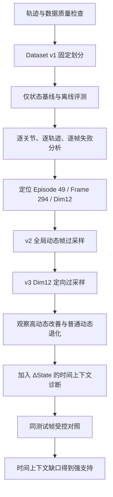

# 具身机器人仅状态输入（State-only）数据飞轮与时间状态实验

本项目整理了一条从数据质量检查（QC，Quality Control）、基线评估、失败定位、数据干预到时间状态验证的完整实验链，用于展示机器人数据运营、数据质量和数据分析能力。

## 项目简介

- **State-only（仅状态输入）**：以 14 维机器人状态（State）预测 14 维动作（Action），不使用图像或历史帧。
- **Temporal State（时间状态）**：在当前状态之外加入状态变化量 `ΔState`，输入维度从 14 增至 28。
- **Data Flywheel（数据飞轮）**：质量检查 → 基线评测 → 失败分析 → 数据干预 → 复测 → 更新问题假设。
- Dataset v1（第 1 版数据集）按完整 Episode（轨迹片段 / 回合）划分：训练 16,000 帧、验证 2,000 帧、测试 2,000 帧；每个 Frame（帧）包含 14 维状态和 14 维动作。

## 结果摘要

| 实验 | 对照结果 | 变化 |
|---|---:|---:|
| 匹配测试集总体 MAE（平均绝对误差） | 0.008924 → 0.006507 | 下降 27.08% |
| 匹配测试集总体 MSE（均方误差） | 0.0002071 → 0.0000941 | 下降 54.54% |
| Dim12 高动态 MAE | 0.056522 → 0.021939 | 下降 61.18% |
| Episode 49 第 292–300 帧 MAE | 0.027062 → 0.011410 | 下降 57.84% |
| 同区域 Dim12 MAE | 0.091338 → 0.028095 | 下降 69.24% |

上述最终对照使用完全相同的 1,995 个测试帧。初始基线报告使用 2,000 帧，不能把两份报告的数值当作同一测试集上的直接对照。

## 数据飞轮与结论



最差帧为 Episode 49、Frame 294：MAE（平均绝对误差）0.0277377，状态距离指标为 0.7548。逐关节分析发现 `right_wrist_rotate`（右腕旋转，Dim12）的动作变化与误差相关系数为 +0.7115，高动态误差约为普通动态的 6.032 倍。Dim10 和 Dim11 的对应误差比为 4.36 倍和 4.13 倍。

数据过采样实验显示明确的取舍：高动态样本占比从约 9.98% 提升至 24.95%；v2 全局动态过采样使整体高动态 MAE 比 v1 下降 3.76%，而 v3 针对 Dim12 的过采样使整体高动态 MAE 比 v1 上升 3.59%。与此同时，v3 的 Dim12 高动态误差下降 27.05%，普通动态误差上升 87.22%。因此，更多目标关节高动态样本能改善局部表现，却可能损害其他分布上的泛化。

加入 `ΔState`（状态变化量）后，KNN（K 近邻）诊断的总体 MAE 下降 7.67%，Dim12 总体 MAE 下降 17.76%，Dim12 高动态 MAE 下降 17.82%。这项 KNN 结果是特征诊断，不与最终神经网络数值混作同一实验。最终匹配控制实验（Matched-Control Experiment）显示，总体 MAE 下降 27.08%，原始失败区域 MAE 下降 57.84%，该区域 Dim12 MAE 下降 69.24%。整体证据更支持“时间上下文 / 状态表征缺口”为主要问题，同时动态数据分布仍是次要因素。

## 仓库结构

```text
state-only-data-flywheel/
├── README.md
├── .gitignore
├── docs/
│   ├── PROJECT_STRUCTURE.md
│   ├── EXPERIMENT_RESULTS.md
│   └── EVIDENCE_INDEX.md
├── dataset_v1/     # v1 训练 / 验证 / 测试数组
├── dataset_v2/     # 全局动态过采样数组
├── dataset_v3/     # Dim12 定向过采样数组
├── models/         # 各阶段最佳模型权重
├── scripts/       # 数据构建、质量检查、训练、诊断与评测脚本
└── reports/       # 可公开的汇总 CSV 与训练历史
```

## 数据集与模型权重

仓库包含 v1、v2、v3 各自的 `train.npz`、`val.npz`、`test.npz`，以及五个阶段权重：`state_policy_best.pt`、`state_policy_v2_best.pt`、`state_policy_v3_best.pt`、`state_policy_matched_best.pt`、`temporal_state_policy_best.pt`。数据数组合计约 4.8 MiB，权重合计约 0.4 MiB。最终匹配评测使用 `state_policy_matched_best.pt` 和 `temporal_state_policy_best.pt`。

这些状态 / 动作数组源自 [LeRobot aloha_static_cups_open 数据集](https://huggingface.co/datasets/lerobot/aloha_static_cups_open)。数据集页面当前标注 MIT 许可证，并附有原始论文引用；本仓库保留上游来源链接，不包含其原始视频。MIT 许可标注仅针对上游数据，不代表本项目脚本或模型权重的单独许可声明。

目录说明和每份报告的用途见 [项目结构](docs/PROJECT_STRUCTURE.md)、[实验结果](docs/EXPERIMENT_RESULTS.md) 和 [证据索引](docs/EVIDENCE_INDEX.md)。

## 数据与复现说明

此仓库包含生成后的状态 / 动作数据集和相关模型权重，但不包含原始视频、缓存、虚拟环境或逐帧预测明细。脚本需要相应依赖才能运行；从上游重建数据集时需要网络访问，视频质量检查还需要额外准备本地 `raw_data/episodes/` 与 `metadata/episode_metadata.csv`。

核心流程脚本按项目根目录运行，例如：

```powershell
python scripts/check_robot_trajectory_qc.py
python scripts/build_dataset.py
python scripts/dataset_qc.py
python scripts/train_state_policy.py
python scripts/evaluate_state_policy.py
python scripts/analyze_baseline_failures.py
python scripts/analyze_data_gap.py
python scripts/build_dataset_v2.py
python scripts/check_dataset_v2_qc.py
python scripts/train_state_policy_v2.py
python scripts/evaluate_state_policy_v2.py
python scripts/build_dataset_v3.py
python scripts/check_dataset_v3_qc.py
python scripts/train_state_policy_v3.py
python scripts/evaluate_state_policy_v3.py
python scripts/diagnose_temporal_context.py
python scripts/train_temporal_state_policy.py
python scripts/train_state_policy_matched.py
python scripts/compare_matched_state_vs_temporal.py
```

完整指标、样本口径和适用限制见实验结果文档。仓库保留了历史实验报告作为证据，不承诺在未提供对应数据与环境时能够直接复现所有结果。

## 术语

- **Episode**：机器人完整轨迹片段 / 回合；**Frame**：单个时间步 / 帧。
- **QC（Quality Control）**：质量检查；**Baseline**：基线模型；**Offline Evaluation**：离线评测。
- **Oversampling**：过采样；**High-dynamic**：高动态；**Matched-Control Experiment**：匹配控制实验。
- **State / Action**：机器人状态 / 动作；**MAE**：平均绝对误差；**MSE**：均方误差。
- **Dim12**：第 12 号动作维度，名称为 `right_wrist_rotate`（右腕旋转）。
